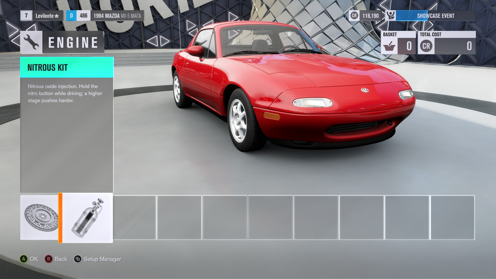
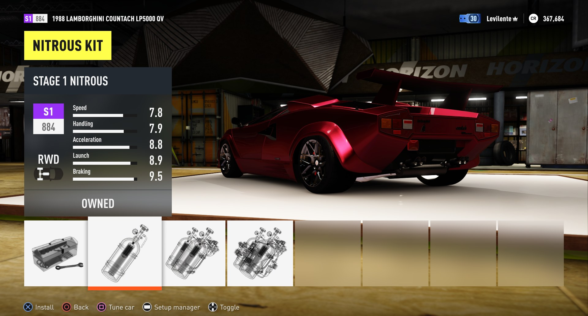
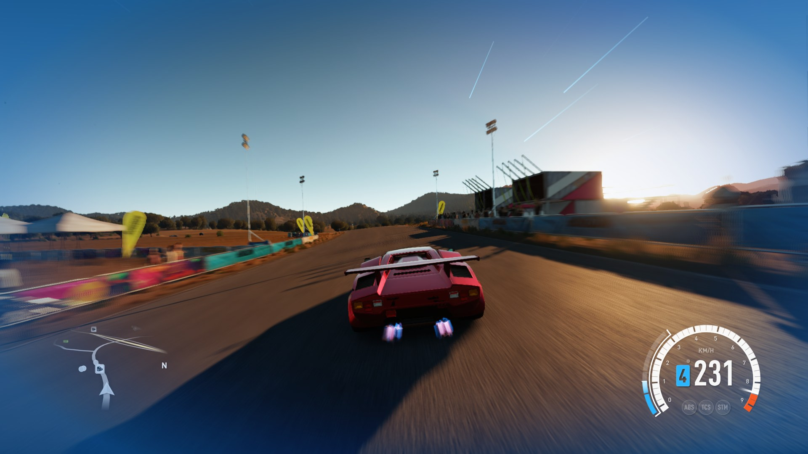

# NitroSystem II for Forza Horizon 3

A **Fast & Furious style nitro** for **Forza Horizon 3** (Xbox One build on PC, via the Azimuth launcher), built on the **[FH3 Mod Platform](https://github.com/Levilente/FH3_ModPlatform)**. You have to **buy it**: nitrous is a real garage upgrade with three stages, fitted per car.

Hold **LB** (or any button you pick) to burn nitro: your car gets a strong push, blue flames shoot from the tailpipes, the speedometer gets a draining NOS gauge, the camera shakes, the field of view widens, a blue vignette pulses at the screen edges, speed lines streak past, the nitro roars and the controller rumbles.





## Where it comes from

NitroSystem II is a continuation of **[NitroSystem](https://github.com/qiangqiang101/NitroSystem)** by qiangqiang101 (internally *FnFNitro*), first extended into a purchasable-upgrade mod for Forza Horizon 2 ([NitroSystem II for FH2](https://github.com/Levilente/NitroSystem-II)) and now ported to Forza Horizon 3. See [Credits](#credits-and-thanks). This is version **1.0.0** of the FH3 port.

- **The Nitrous Kit is an upgrade you buy.** **Garage > Upgrades > Engine > Nitrous Kit**: *Stock*, *Stage 1*, *Stage 2*, *Stage 3*. Prices default to 3 000 / 6 000 / 12 000 CR and are configurable. The kit is registered through the platform's upgrade bridge, so it behaves like a normal upgrade (price, owned marker, installed marker).
- **Stored per owned car.** Fitting stage 2 on one car does not give nitro to your other cars, not even to other cars of the same model. No kit, no nitro.
- **Each stage pushes harder**: 1.2x / 1.4x / 1.6x boost by default, configurable per stage.
- **The NOS gauge is only shown on cars that have the kit.**
- **Extra effects while nitro burns**: wider field of view, a pulsing blue vignette and speed lines along the screen edges (each can be switched off).

## Features

- **Nitro on LB, or any button you choose.** Any connected controller; remap it to another button, d-pad direction or trigger (see [Nitro Button](#settings)). There is no keyboard key.
- **A real tank.** Nitro drains while you hold the button and recharges when you let go. Run it dry and it locks out until you release the button and have recharged a little.
- **Buildup curve.** The push ramps up over a short time instead of snapping on.
- **Only your car.** AI racers and traffic are never boosted.
- **Stays on the road.** The push follows the horizontal direction of the car's nose, and nothing is applied while the car is airborne (or for a moment after landing).
- **Only while driving.** Nitro works only while the game simulates your car; the tank does not drain or recharge while the game is paused.
- **NOS gauge on the speedometer.** The **analog** and the **digital** speedometers both get a NOS bar that drains as you use nitro. Two HUD themes: the original yellow bar or the Fast & Furious cyan bar.
- **Exhaust flames.** Blue flames come out of your car's real tailpipes while nitro is held (the mod drives the game's own backfire effect).
- **Sound, rumble, camera shake.** A boost sound and a stop sound (built into the DLL), a rumble that ramps up with the boost, and a camera shake.
- **Refill and rewind.** The tank refills when a race starts, you change car or you fast travel, and rewinding gives back the nitro used since the rewind point (both can be switched off).
- **In-game settings** on **Pause > MODS** (the platform's Mods page).

## Requirements

| What | Version |
|---|---|
| Forza Horizon 3 on PC with the **Azimuth** launcher | Xbox One build 1.0.125.0 (the one the platform targets) |
| **[FH3 Mod Platform](https://github.com/Levilente/FH3_ModPlatform)** | **1.0.0 or newer** (API 12) |

The platform is the `DWrite.dll` (and `d3dcompiler_47.dll`) next to `azimuth.exe`. If you use any other platform-based mod you already have it; otherwise download the platform zip from its [releases page](https://github.com/Levilente/FH3_ModPlatform/releases) and follow its README.

## Installation

1. Close the game.
2. Download `NitroSystemII.dll` from the [latest release](../../releases/latest).
3. Copy it to `<your Azimuth folder>\fh3-mods\` (the folder next to `azimuth.exe`; it exists once the platform is installed).
4. Start the game through Azimuth. Open a car in the garage: **Upgrades > Engine > Nitrous Kit**, buy a stage, go driving and hold **LB**.

To check that it loaded, open `fh3-mods\platform.log` and look for the lines of `NitroSystem II`, for example `NitroSystem II initializing ...` and `FH3 build: Nitrous Kit stage ...`. Updates are announced by the platform's Updates page when a newer release exists.

### Coming from the FH2 version

The FH2 and FH3 mods are separate: the FH3 DLL only works with the FH3 platform and the FH2 one with the FH2 platform, and their `.ini` files are not interchangeable. Start with the defaults.

## Settings

Everything is on **Pause > MODS**; the values are saved to `fh3-mods\NitroSystemII.ini`.

| Setting | Range | Default | What it does |
|---|---|---|---|
| Nitro System | On / Off | On | Turns nitro on or off. A Nitrous Kit is still needed on the car. |
| Nitro Button | 1 - 16 | 1 (LB) | Which button burns nitro (numbers below). Applies right away. |
| Nitro Debug Overlay | On / Off | Off | Draws debug info over the game (borderless or windowed mode only). |
| HUD Theme | 1 - 2 | 2 | 1 original (yellow NOS bar), 2 Fast & Furious (cyan NOS bar). **Needs a game restart.** |
| Hide Nitro Gauge Without Kit | On / Off | On | Hides the NOS gauge on cars with no Nitrous Kit. |
| Nitro Tank Capacity (sec) | 5 - 60 | 5 | Seconds of nitro in a full tank. |
| Nitro Buildup Time (sec) | 0.1 - 2.0 | 0.5 | How long the push takes to ramp up. |
| Nitro Recharge Rate | 0.0 - 1.0 | 0.2 | Seconds of nitro restored per second while not boosting. |
| Nitro Sound Volume | 0 - 100 | 50 | Volume of the boost and stop sounds. |
| Nitro Camera Shake | 0 - 100 | 65 | Camera shake while nitro burns. 0 turns it off. |
| Nitro Wider FOV | 0 - 30 | 10 | How much wider the field of view gets while nitro burns. 0 turns it off. |
| Nitro Blue Vignette | On / Off | On | A pulsing blue vignette at the screen edges while nitro burns. |
| Nitro Speed Lines | On / Off | On | Blue streaks along the screen edges. |
| Backfire on All Cars | On / Off | On | Lets every car backfire, which the exhaust flames need. **Needs a game restart.** |
| Refill Nitro on Race Start | On / Off | On | Refills the tank at race start, changing car or fast travel. |
| Refund Nitro on Rewind | On / Off | On | Rewinding gives back the nitro used since the rewind point. |
| Nitro Controller Rumble | On / Off | On | Rumbles the controller while nitro burns. |

The upgrade is configured in the ini only (written with its defaults the first time, then editable; a game restart applies it):

```ini
[Upgrade]
Area=1        ; where the Nitrous Kit is listed: 1 Engine (default)
Price1=3000   ; price of stage 1 / 2 / 3, in CR
Price2=6000
Price3=12000
Boost1=1.2    ; push of stage 1 / 2 / 3
Boost2=1.4
Boost3=1.6

[FH3]
PowerScale=2.0   ; extra torque = (boost - 1) x PowerScale; 2 gives +40 / +80 / +120 % torque on stages 1 / 2 / 3
```

Which stage is fitted to and owned by each car is kept by the platform's upgrade bridge (older `[GarageNitro]` / `[GarageOwned]` entries in the ini are moved over once).

**Nitro Button numbers** (the Mods page can only show numbers; in the ini you write the name, for example `NitroButton=LB`):

| # | Name | Button | # | Name | Button |
|---|---|---|---|---|---|
| 1 | `LB` | Left bumper | 9 | `DPadUp` | D-pad up |
| 2 | `RB` | Right bumper | 10 | `DPadDown` | D-pad down |
| 3 | `A` | A | 11 | `DPadLeft` | D-pad left |
| 4 | `B` | B | 12 | `DPadRight` | D-pad right |
| 5 | `X` | X | 13 | `Back` | Back / View |
| 6 | `Y` | Y | 14 | `Start` | Start / Menu |
| 7 | `LS` | Left stick click | 15 | `LT` | Left trigger |
| 8 | `RS` | Right stick click | 16 | `RT` | Right trigger |

Pick a button the game does not already use while driving, or it will do both at once.

`HudTheme` in the ini is `FF` (default) or `Original`. `BackfireOnAllCars=1` makes the mod change a game database query so every car can backfire, which the flames depend on; turn it off to leave the game's backfire settings alone (flames then only work on cars the game already lets backfire).

## Uninstalling

Close the game first. To switch the mod off without uninstalling it, open **Pause > MODS** and turn **Nitro System** off.

1. Delete `fh3-mods\NitroSystemII.dll` and `fh3-mods\NitroSystemII.ini` (your settings and the fitted stages).
2. Start the game once. The files the mod handed to the game are dropped by the platform and the speedometer, flames and backfires are back to stock.

Nitrous Kits you bought are recorded by the platform's upgrade bridge; without the mod those cars simply have no nitro. Keep a backup of your save if you care about it.

## Known limitations

- Only the player's car gets nitro.
- The NOS gauge replaces the game's HUD speedometer file while the mod is active (through the platform's override mechanism, nothing is changed on disk), so another mod replacing the same HUD file will conflict.
- The mod is built for the FH3 build named above; a different game build needs a new platform and mod release.

## Building from source

You need a C++20 cross compiler for Windows x64; the release is built with [llvm-mingw](https://github.com/mstorsjo/llvm-mingw) (or Zig 0.15.x). On Linux or macOS:

```sh
bash scripts/build.sh
```

On Windows run `BUILD_WINDOWS.cmd` (drop `zig.exe` onto it, or have `zig` on PATH). Both produce `dist/NitroSystemII.dll`. The HUD files, flame effect, sounds and icons are compiled into the DLL from the generated `src/hud_data.h` and `src/icon_data.h`.

- `include/fh3mod.h` is the FH3 platform's public header (copy it from the platform repo after API changes).
- `scripts/gen_hud_data.py` rebuilds `src/hud_data.h`; `scripts/gen_icons.py --prefix nitro` rebuilds `src/icon_data.h` ([docs/ICON_GUIDE.md](docs/ICON_GUIDE.md)); `scripts/gen_speedlines.py` regenerates the speed lines in the HUD XAML.
- Host tests (g++, any OS): `sh tests/run_tests.sh`.
- Porting notes and research: [docs/FH3_PORT.md](docs/FH3_PORT.md).

## Credits and thanks

See [CREDITS.md](CREDITS.md) for the full list. In short:

- **[qiangqiang101](https://github.com/qiangqiang101)**, author of **[NitroSystem](https://github.com/qiangqiang101/NitroSystem)** (internally *FnFNitro*): boost, flames, HUD gauge, sounds and settings page all come from it (MIT).
- **[Trinculo54](https://github.com/Trinculo54)**, for the **[FH2 Mod Platform](https://github.com/Trinculo54/fh2-mod-platform)** that the FH3 platform is derived from (MIT).
- **[RokkuDayo](https://github.com/RokkuDayo)**, for **[Forza Horizon 2 Extra Options](https://github.com/RokkuDayo/forzahorizon2_extraoptions)**.
- **Levilente**, the FH3 port, the Nitrous Kit upgrade, per-car stages, effects, icons and the documentation.

## License

**MIT**, see [LICENSE](LICENSE) (the copyright notice of the upstream NitroSystem licence, which names Bartholomew Ho, is kept; modifications are by Levilente). `include/fh3mod.h` is the platform's header, MIT, see [LICENSE-fh2mod-MIT.txt](LICENSE-fh2mod-MIT.txt). The HUD files, particle file and sounds are covered in [CREDITS.md](CREDITS.md).

This is an unofficial fan modification. Forza Horizon 3 is a trademark of Microsoft / Playground Games.
